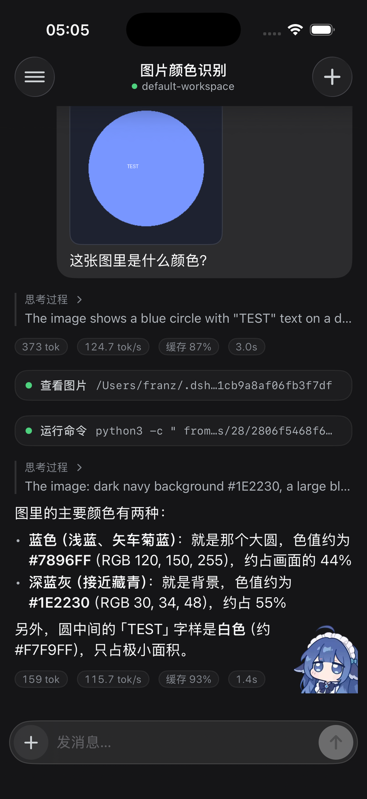
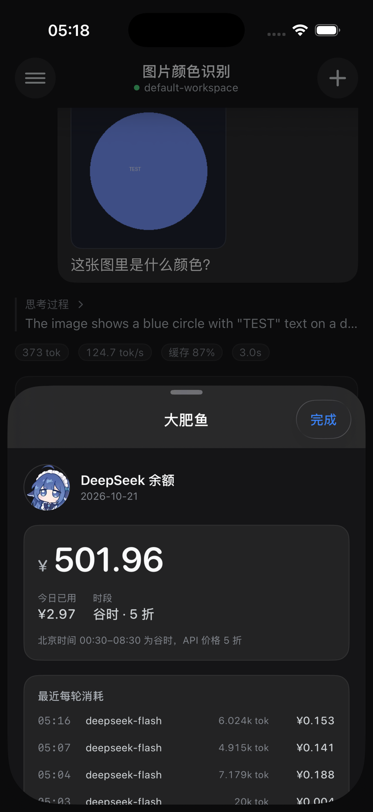
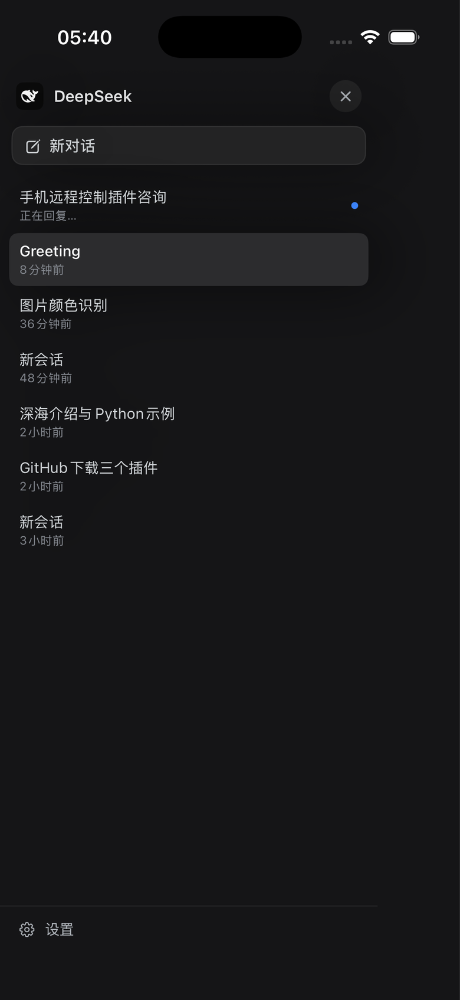

# Pocket · dsh-iphone-control

> **Unofficial community plugin. Not affiliated with or endorsed by DeepSeek.**
> 非官方社区插件，与 DeepSeek 无关联，亦未获其认可。

把 [DeepSeek Harness](https://www.deepseek.com/harness/) 装进口袋：一个 **iPhone 原生 App** 加一个 **手机端 Web UI**，都通过你自己的 Tailscale 网络直连电脑上的 DSH。不开公网端口，不经过任何第三方中转。

<p align="center">
  
  
  
</p>

## 能做什么

- **流式回复**：正文逐字出现，带打字光标；推理过程可折叠查看
- **工具卡片**：`运行命令 / 读取文件 / 查看图片…`，带运行状态，点开看参数与输出
- **会话管理**：切换历史会话、新建会话、看到「正在回复」状态
- **打断**：流式途中一键停止（真的会取消当前轮）
- **发图**：相册选图，自动压缩后随消息发送
- **每轮统计**：`tok · tok/s · 缓存命中% · 耗时` 一行展示在回复下方
- **大肥鱼**：导航栏的鱼图标打开余额面板 —— 余额、今日已用、峰谷时段、最近每轮消耗（读 `dsh-whale-widget` 的本地账本）
- **原生体验**（iOS）：原生滚动与文本选择、触感反馈、深色界面、Liquid Glass 导航栏
- **PWA**：不装 App 也能用 Safari 打开，「添加到主屏幕」后是全屏独立窗口

## 工作原理

```
iPhone App / Safari
        │  Tailscale（你自己的私有 WireGuard 网络）
        ▼
tailscale serve :8931  ──▶  127.0.0.1:64044（DSH 桌面进程）
                                  └─ /pocket/* 插件 ──▶ sessionController
```

- DSH 的 webServer 仍然只监听 `127.0.0.1`，公网不可达
- `tailscale serve` 只在你的 tailnet 内应答
- `/pocket` 有自己的配对令牌（`~/.dsh/pocket/state.json`），与 DSH 的浏览器 cookie 相互独立

## 一、装 Host 插件

```sh
dsh plugin --profile desktop add /path/to/this/repo
```

然后把 `dsh-pocket` 加进 profile 的 `dsh.profile.bundles`：

```json
{
  "dsh": { "profile": { "bundles": [
    "@deepseek-ai/dsh-base",
    "@deepseek-ai/dsh-web-app",
    "dsh-pocket"
  ] } }
}
```

重启 DSH。插件启动时会打印 `[dsh-pocket] ready — open http://…/pocket/?token=…`。

## 二、暴露给 tailnet

桌面版每次启动会随机选端口，而 `tailscale serve` 需要一个固定目标。在
`~/.dsh/profiles/desktop/cordis.patch.yml` 里固定端口：

```yaml
- id: webserver
  name: '@deepseek-ai/dsh-host-webserver'
  inject: [webStartup]
  config:
    host: 127.0.0.1
    port: 64044
    tls: !!js ctx.webStartup.tls
    compression: gzip
    compressionLevel: 1
    compressionThresholdBytes: 1024
```

然后：

```sh
# 推荐：HTTPS + 443（Tailscale 自动签发 MagicDNS 证书，PWA 也能离线缓存）
tailscale serve --bg --https=443 http://127.0.0.1:64044
```

手机（同一 tailnet）访问：

```
https://<机器名>.<tailnet>.ts.net/pocket/?token=<token>
```

> 实测 `--http=<port>` 这条明文端口在 userspace-networking 模式下手机连不上，
> 用 `--https=443` 即可；HTTP 下 Safari 也不能装 Service Worker。

Safari 打开一次换 cookie，之后「分享 → 添加到主屏幕」就是全屏 App。
令牌在电脑的 `~/.dsh/pocket/state.json`。

## 三、编译 iOS App

```sh
open ios/Pocket.xcodeproj
```

1. 选中 **Pocket** target → Signing & Capabilities → 选择你的 Team
2. 把 **Bundle Identifier** 改成你自己唯一的（仓库默认是 `com.example.pocket`）
3. 连上 iPhone，选中设备，`⌘R`

或者一条命令装到已连接的 iPhone：

```sh
./scripts/install-device.sh
```

脚本会：读 `~/.dsh/pocket/state.json` 的 token → 用你选中的 Team 自动签名
（免费团队 7 天、付费团队 1 年）→ 去掉 macOS 给产物加的 `com.apple.provenance`
扩展属性 → 安装并启动。可用环境变量覆盖：

| 变量 | 默认值 | 说明 |
| --- | --- | --- |
| `DEVICE_ID` | 自动取第一台已配对设备 | 设备 UDID |
| `TEAM` | 第一张开发证书的团队 | 想用付费团队直接 `TEAM=你的TeamID` |
| `POCKET_BUNDLE_ID` | `com.example.pocket.dev` | 安装用的 bundle id |
| `POCKET_BASE_URL` | 必填 | 服务器地址，例如 `https://<机器名>.<tailnet>.ts.net/pocket` |
| `POCKET_TOKEN` | 读 `~/.dsh/pocket/state.json` | 配对令牌 |

这些值可以写进 `scripts/local.env`（已 gitignore），脚本会自动加载。

> 同一台设备上换签名团队/bundle id 时需要先卸载旧 App，脚本已处理。
> 首次运行若提示「不受信任的开发者」，到 设置 → 通用 → VPN 与设备管理 → 信任即可。

## 目录

```
index.js            Host 插件：静态路由、令牌鉴权、会话 feed、JSON API
cordis.patch.yml    插件行
web/index.html      PWA 外壳
web/style.css       视觉
web/app.js          渲染、Markdown、轮询、输入区
web/unlock.html     配对页
ios/                SwiftUI 原生 App（Xcode 工程）
docs/               截图
```

## HTTP API（App 与 Web 共用）

| 方法 | 路径 | 说明 |
| --- | --- | --- |
| GET | `/pocket/api/ping` | 鉴权探针 |
| GET | `/pocket/api/sessions` | 会话列表 |
| GET | `/pocket/api/session?id=` | 打开会话（尾部历史 + 游标） |
| GET | `/pocket/api/events?id=&after=` | 增量事件与流式文本 |
| GET | `/pocket/api/older?id=&before=` | 向前翻历史 |
| POST | `/pocket/api/send` | 发送文字 / 图片 |
| POST | `/pocket/api/cancel` | 停止当前轮 |
| POST | `/pocket/api/new` | 新建会话 |

所有 `/api/*` 都需要 `x-pocket-token` 头或配对后的 cookie。

## 安全说明

- 配对令牌等同于「可以让你电脑上的 Agent 执行操作」的凭据，请勿公开
- `tailscale serve` 只有你自己的 tailnet 能访问；可以用 Tailscale ACL 进一步限制设备
- 仓库中不包含任何令牌；首次运行 App 时手动配对

## 素材

桌宠形象与动画（`pet.png`、`rua.gif`）来自 [dsh-whale-widget](https://github.com/MeteorNOX/DeepSeek-Balance-Whale-Widget)（MIT）。

## License

MIT
